  <picture>
    <source media="(prefers-color-scheme: dark)" srcset="assets/header-abstract-dark.svg" />
    
  </picture>

Full Stack Software Engineer in Mexico City with 6 years shipping production web applications, from architecture through deployment.  
Open to Full Stack roles, remote or anywhere.

  
  
  
  

  
  
  
  
  
  
  

### Featured

**[Qarta Online](https://www.qartaonline.com)** - Cofounder and Lead Engineer. Restaurant menu websites for 40+ restaurants across 7 Mexican states and Los Angeles.

**[Mexico Tech Week](https://mexicotechweek.mx)** - AI Full Stack Engineer, volunteer. Migrated the site from Webflow to Next.js.

Previously Software Developer 2 at Oracle (Oracle Utilities CC&B and C2M), Frontend Developer at Puffer Finance, and Full Stack Developer at GPT4Sales.
